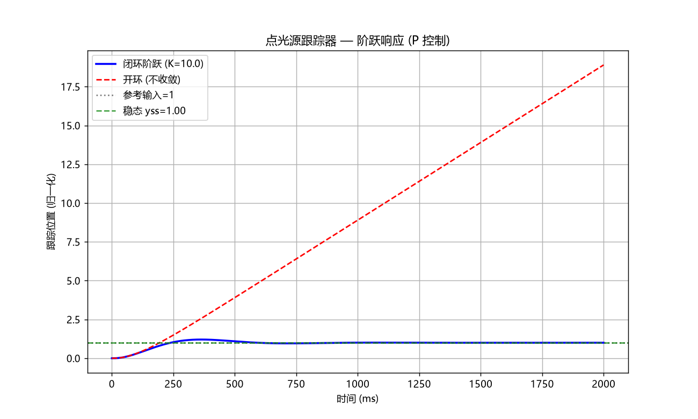
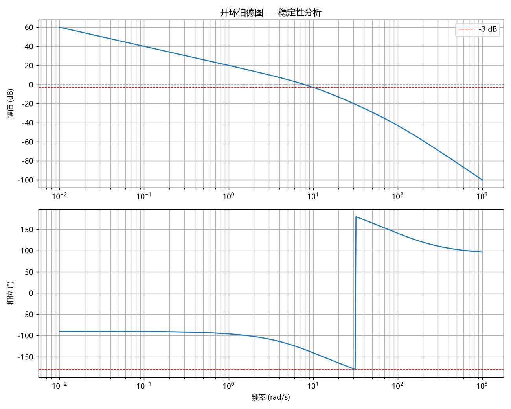
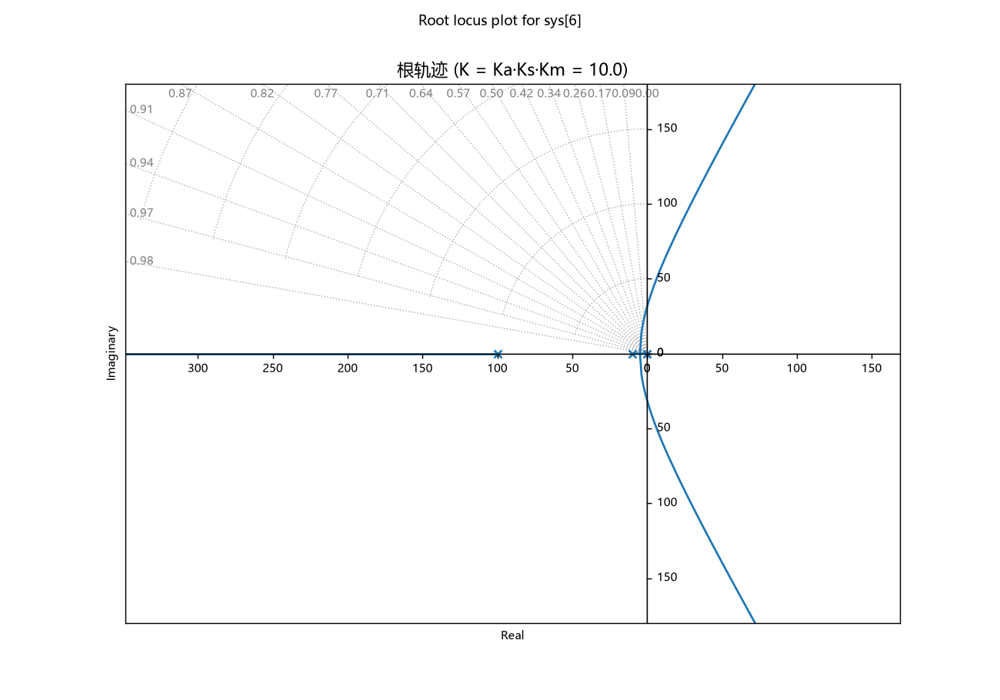

# 点光源跟踪器 — 控制原理分析报告

> 数据与图由 `3-控制分析.py` 生成（Python control 库），图在 `report/`。

## 1. 系统建模

以单轴（水平 X）为例，完整闭环为**位置伺服系统**，三个环节级联：

| 环节 | 传递函数 | 参数 |
|------|---------|------|
| 光敏传感 | $G_s(s) = \dfrac{K_s}{\tau_s s + 1}$ | $K_s=0.5$, $\tau_s=10ms$ |
| 差动放大 | $G_a(s) = K_a$ | $K_a = R_f/R_{in} = 100k/10k = 10$ |
| 电机+负载 | $G_m(s) = \dfrac{K_m}{s(\tau_m s+1)}$ | $K_m=2.0$, $\tau_m=100ms$ |

**开环**：
$$G(s) = G_a G_s G_m = \frac{10}{s(0.001s^2 + 0.11s + 1)} = \frac{10}{0.001s^3 + 0.11s^2 + s}$$

**闭环**（单位负反馈）：
$$T(s) = \frac{G(s)}{1+G(s)} = \frac{10}{0.001s^3 + 0.11s^2 + s + 10}$$

系统为**三阶**，含一个积分环节（I 型系统）。

## 2. 阶跃响应（跟踪性能）

| 指标 | 数值 | 说明 |
|------|------|------|
| 稳态值 yss | 1.000 | 完全跟踪参考 |
| **稳态误差** | **≈ 0** | I 型系统对阶跃输入无静态误差 ✓ |
| 超调量 Mp | 20.6% | 中等，源自三阶系统的欠阻尼极点 |
| 调节时间 ts | 0.85 s | 5% 带，较快 |
| 上升时间 tr | 0.21 s | 响应敏捷 |

**分析**：由于含积分环节（电机的位置-速度固有积分），P 控制即可实现对阶跃的零稳态误差——
这是本系统"电机位置伺服"的核心特性，也是控制原理课的关键结论。

## 3. 稳定性分析（伯德图）

| 指标 | 数值 | 判定 |
|------|------|------|
| **相位裕度 PM** | **47.4°** | ✓ >30°，稳定 |
| 增益裕度 GM | 20.8 dB | ✓ 稳定 |
| 穿越频率 | 7.84 rad/s | 带宽适中 |

**结论**：系统稳定，相位裕度 47.4° 有良好稳定裕度，兼顾了动态响应与鲁棒性。

## 4. 根轨迹（增益对稳定性影响）

根轨迹显示：增益 K 增大时，闭环极点向虚轴移动，系统趋向不稳定。这正验证了
经典结论——**增益提高改善稳态精度但牺牲稳定性**。

### 参数灵敏度

| 增益 K | 相位裕度 PM | 稳定性 |
|--------|------------|--------|
| 1.0 | 83.7° | 稳定（保守）|
| 10.0 | 47.4° | 稳定（设计点）|
| 31.6 | 22.2° | 临界 |
| 100.0 | 1.6° | 接近不稳定 |

## 5. 结论

1. 系统为 I 型三阶位置伺服系统，P 控制下**对阶跃输入零稳态误差**，相位裕度 47.4° 稳定。
2. 超调 20.6% 主要来自三阶系统的振荡极点，可**增加阻尼**（如电机减速器摩擦、
   或加入微分反馈 K_d 形成 PD 控制）改善，代价是响应变慢。
3. 增益是稳定性的核心权衡参数：**Ka↑ → 稳态精度好但 PM↓**；实际可用光敏模块的
   电位器调灵敏度、或用 Rf/Rin 调 Ka 来平衡。

## 6. 与课程知识对应

| 本系统 | 控制原理知识点 |
|--------|--------------|
| 光敏分压 + 差动 | 误差检测（反馈信号）|
| LM358 差动放大 | 比例控制器 K_p |
| 电机位置积分 | I 型系统、被控对象 |
| TB6612 驱动 | 功率放大环节 |
| 机械支架转动 | 负反馈闭环 |
| 相位裕度/根轨迹 | 稳定性判据、根轨迹法 |
